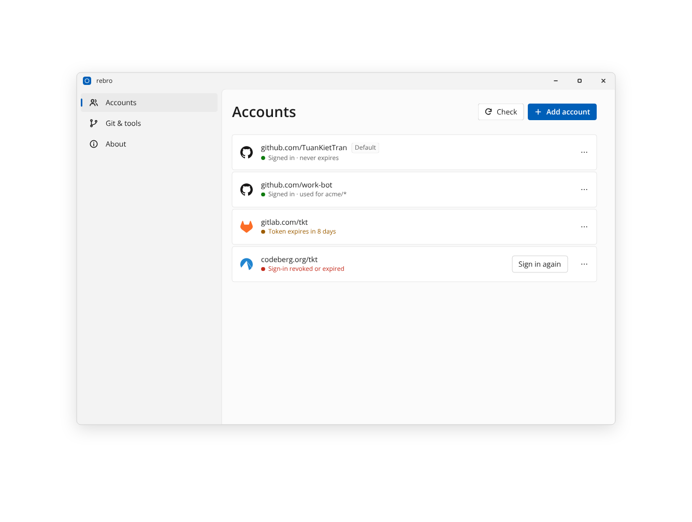
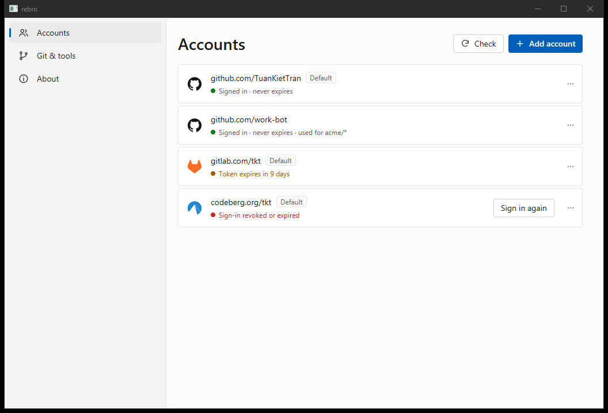
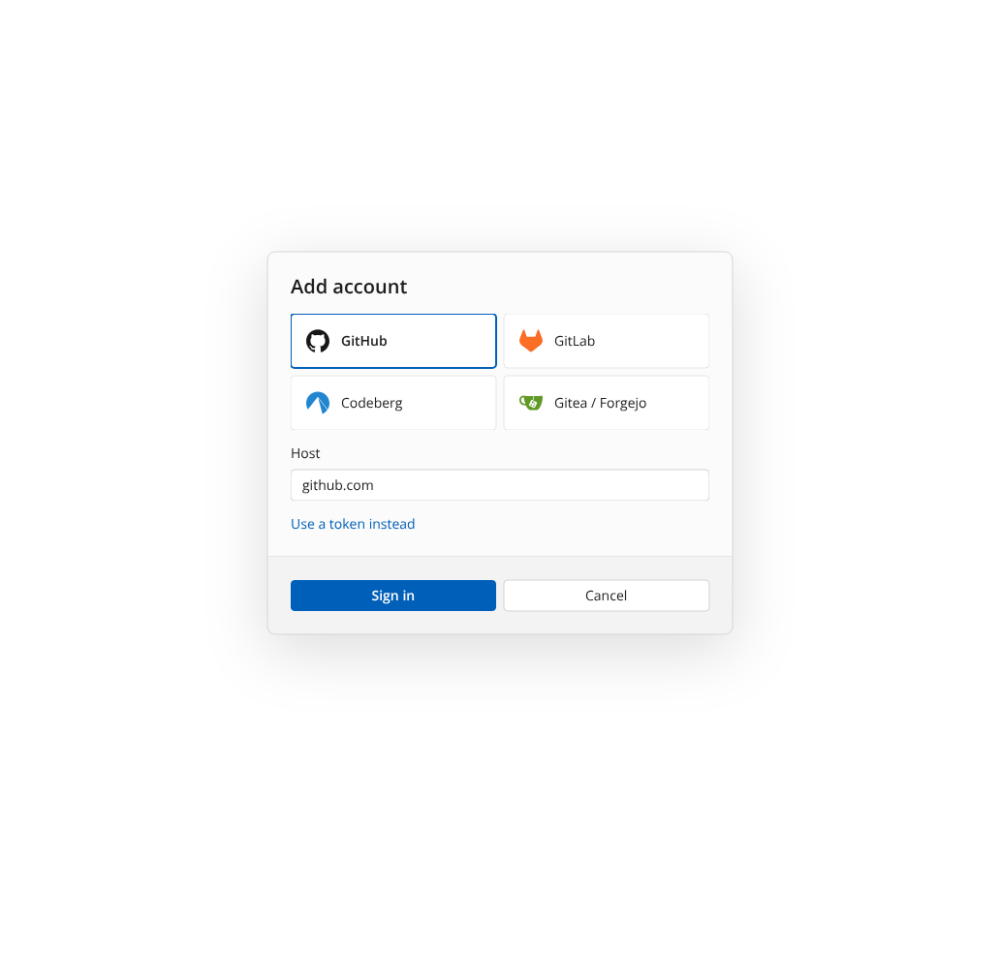
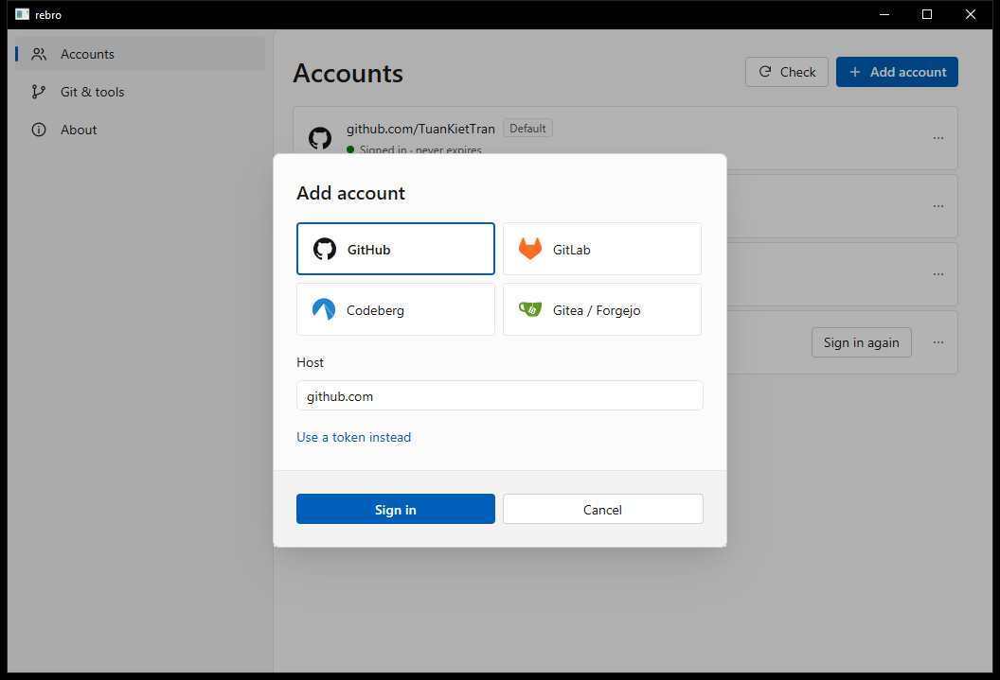
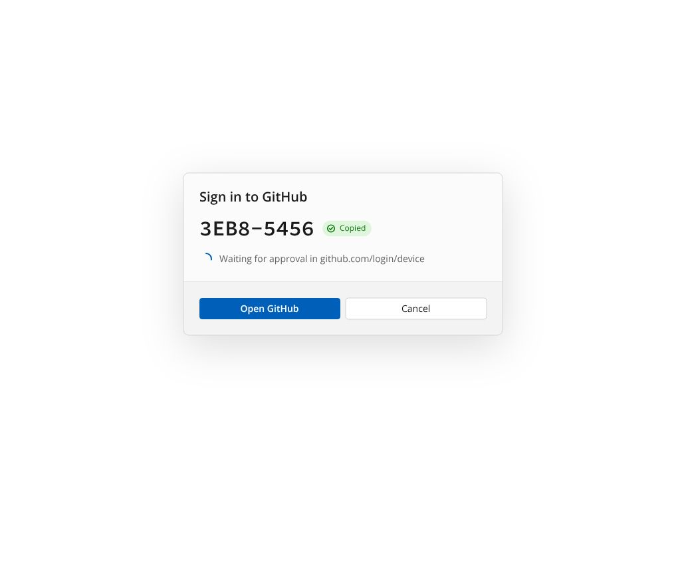
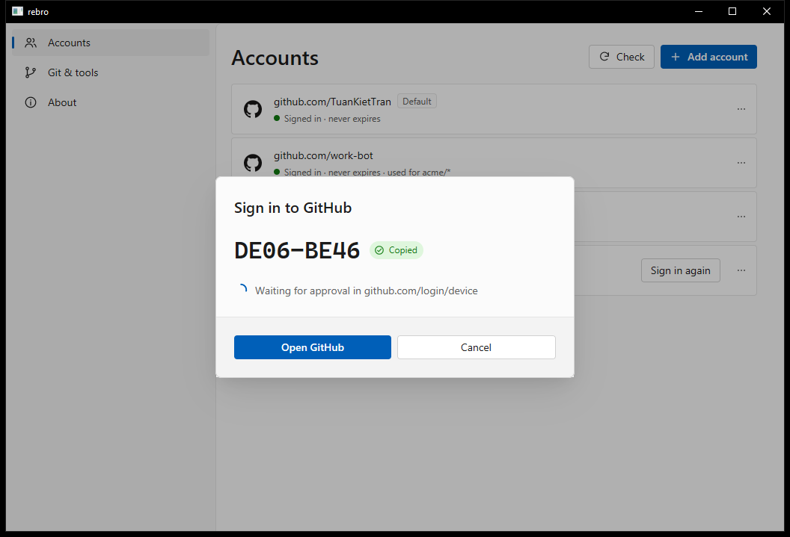
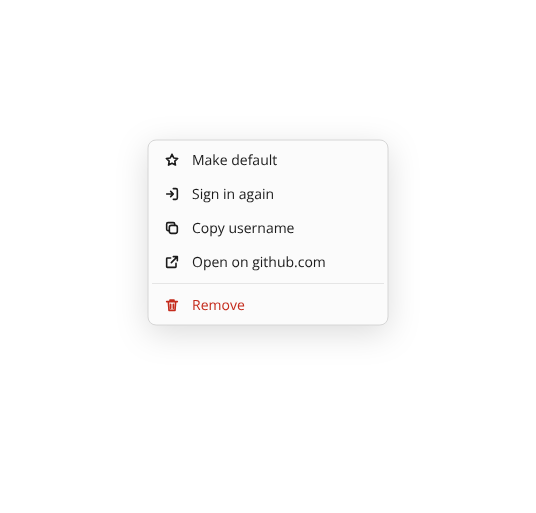
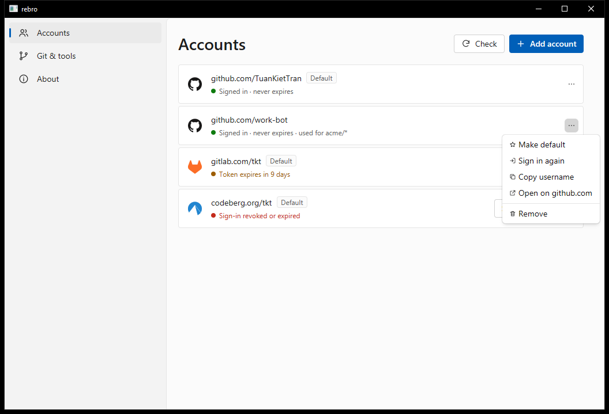
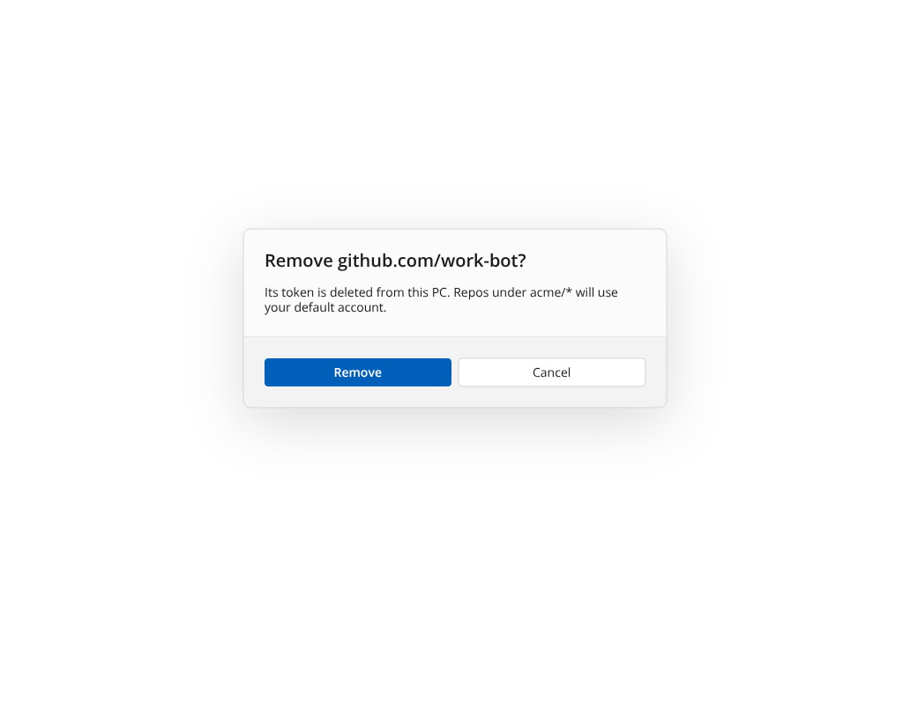
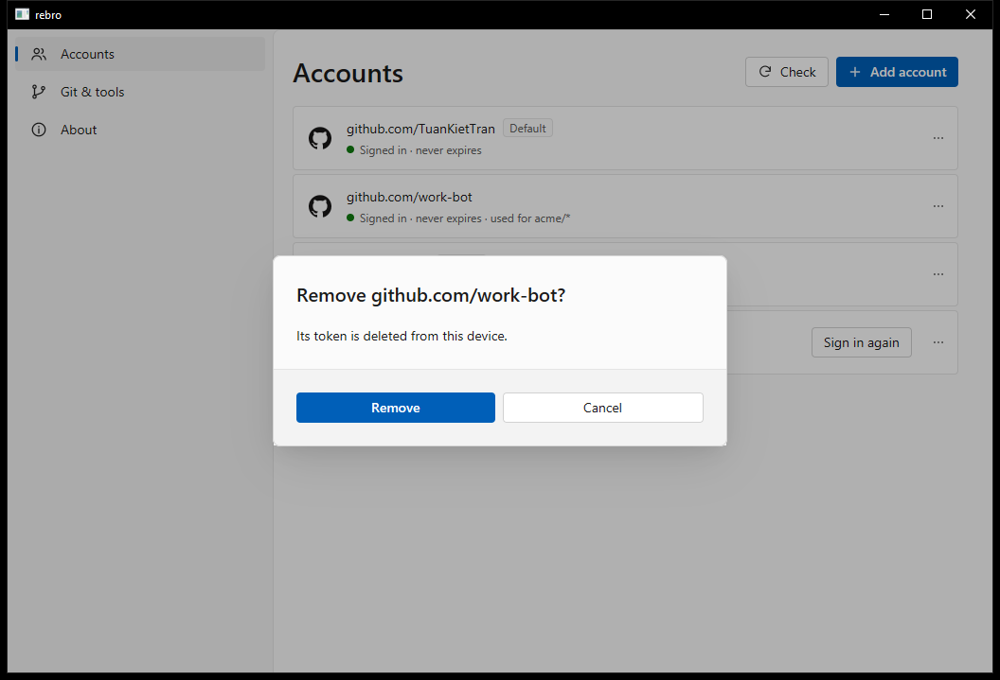

# rebro design

Source of truth: the Penpot file **rebro**.
- **Pages:** Windows, macOS, Linux (GNOME).
- **Flows (View mode):** *1 · First sign-in*, *2 · Manage accounts*, *macOS · Add account*, *GNOME · Add account*.

| Penpot design | Running app |
|---|---|
|  |  |
|  |  |
|  |  |
|  |  |
|  |  |

App screenshots come from driving the real 
ebro-gui in an isolated config with sample accounts. `app/preview-*` are the macOS and GNOME looks, previewed on Windows with `REBRO_STYLE` (so Segoe UI instead of SF Pro or Cantarell).
